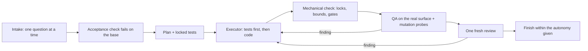

# keryx: a test-first workflow plugin for Claude Code

[](https://github.com/jacksnxly/keryx/actions/workflows/test.yml)
[](https://github.com/jacksnxly/keryx/releases)
[](LICENSE)

**keryx makes a coding agent prove its work.** It is a [Claude Code](https://code.claude.com/docs) plugin for fixing bugs and red CI jobs, building features from a spec, and reviewing pull requests: the agent writes an acceptance check that fails first, locks the tests, lets a cheaper model write the code, checks the result mechanically, runs QA on the real app, breaks the change on purpose to see that the tests notice, and gets one fresh code review before anything counts as done.

- **Test-driven by default**: the acceptance check fails before the work and passes after; locked tests cannot be edited by the agent that writes the code.
- **Cheaper executors**: a Sonnet subagent ships with the plugin; the Cursor CLI, a GLM Coding Plan or Cursor Cloud can take over, with automatic fallback when one fails or hits a usage limit.
- **Real QA and code review**: scripted and exploratory QA with kept evidence, mutation probes, and a review with a written bar (P0–P3), a production-reach question and two reviewers for risky changes. The reviewer's brief ships with the plugin, so the bar is the same in every run.
- **Finished means finished**: a run counts as done only when its log records what shipped and a well-formed fresh review covers the shipped commit.
- **Guards architecture**: guard tests, import contracts, dependency rules and CI config changed by an executor are flagged; a domain-driven design lens applies wherever a change touches business rules.
- **Stays inside your limits**: it asks once how far it may go (commit, push, PR, merge, deploy) and never goes further.



## Install

```bash
claude plugin marketplace add jacksnxly/keryx
claude plugin install keryx@keryx
```

Inside a session the same works as `/plugin marketplace add jacksnxly/keryx` and `/plugin install keryx@keryx`. Requirements: Claude Code, git, Python 3.11 or later.

## Use

Ask for the work and say keryx, or call it directly:

```
/keryx:keryx fix the failing checkout test
/keryx:keryx build the export button from docs/spec/export.md
/keryx:keryx review and fix this branch
/keryx:keryx review this PR, findings only
```

keryx remembers the choices you make that will come up again (your executor order, how far it may go, a repository's traps) in `~/.config/keryx/memory.md` and, per repository, in `.keryx/memory.md`. It never stores a secret; edit or delete either file at any time.

The first time it needs an executor, keryx runs a short setup: it shows which executors it found on this machine and asks which to use, in which order. The answer is saved in `~/.config/keryx/config.json`; say "keryx setup" to change it.

| Executor | What you need |
|---|---|
| `subagent` | Nothing: the plugin's `keryx:executor` agent on Sonnet. Always available. It runs with your session's environment, without MCP tools, and cannot push from its worktree. |
| `cli` | The [Cursor CLI](https://cursor.com/cli), logged in (`agent login`). |
| `glm` | A GLM Coding Plan key in `$GLM_API_KEY` or `~/.config/glm/coding-plan.key`. |
| `cloud` | A Cursor API key and the repository on GitHub. |

When an executor fails (an error, a stop, a dispatch that never starts), keryx moves the same work to the next one in your order, and writes the code itself after the last.

## FAQ

**How do I make Claude Code write tests first?** Install keryx and ask for the change with `/keryx:keryx`. Every M or L task starts with a check that fails on the current code, then locked tests the executor must make pass without editing them.

**Can a cheaper model write the code?** Yes. Run the one-time setup and keryx uses your executors in order: the bundled Sonnet subagent, the Cursor CLI, a GLM Coding Plan or a Cursor Cloud Agent. If one errors or hits a usage limit, the next one continues on the same task.

**Will it push, merge or deploy on its own?** Only as far as you allow at the start of the run, and never past your repository's own rules.

**Does it work on Linux and macOS?** Yes; CI runs on Linux, and it is used daily on macOS.

**Is it a code review tool?** It includes one: `/keryx:keryx review this PR` reviews, validates every finding against the code and fixes the confirmed ones with a failing test each; add "findings only" to change nothing.

## How a run goes

1. **Size the work.** S is done inline; M gets a plan, an executor and one review; L is split into slices that run in parallel.
2. **Intake.** keryx reads what it can, asks only what it cannot find, one question at a time, and asks once how far it may go: commit, push, open a PR, merge, deploy.
3. **An acceptance check that fails first.** Who accepts the work and what they look at becomes a command, a test or a comparison, run on the base before anything is built.
4. **Plan and locked tests.** Decisions and exact tests, no implementation code. The tests are locked: an executor that changes one fails the check.
5. **Execute.** Tests first, shown to fail for the stated reason, then the code.
6. **Check.** Mechanical first (locked tests intact, diff inside its bounds, architecture gates untouched, no assistant attribution), then QA on the real surface and mutation probes that break the change on purpose.
7. **One fresh review** of the whole branch from a brief that ships with keryx, each finding checked before it is acted on.
8. **Finish** within the autonomy, with a short report committed next to the change (`docs/keryx/<date>-<slug>.md`): what changed, the proof, what is open, and every ruling made on your behalf. `keryx.py finish` refuses until the run log has a finish row, the review covers the shipped commit and the report is there.

Every decision is logged as it is made (`.keryx/runs/<slug>/decisions.tsv`), so a run can be picked up after a context reset.

## Where keryx keeps its files

```
<your repository>/
├── .keryx/                     ignored by git (it carries its own .gitignore)
│   ├── memory.md               this repository's traps
│   ├── runs/<slug>/            one folder per task
│   │   ├── PLAN.md             decisions and locked tests
│   │   ├── decisions.tsv       the run log
│   │   ├── locked/  rounds/    locked test blocks, each executor round
│   │   ├── review/             the reviewer's brief and findings
│   │   └── qa/QA.md            QA steps, screenshots, responses
│   └── glm/<slug>/             a GLM executor's own Claude Code config
├── docs/keryx/
│   └── <date>-<slug>.md        the run's report, committed with the change
└── .worktrees/                 ignored by git (it carries its own .gitignore)
    └── <runner>-<slug>/        each executor's worktree
```

Screenshots and executor logs never leave `.keryx/`, since they can show real data. `git clean -fdx` deletes `.keryx/`. A submodule keeps its own `.keryx/`; a bare repository keeps it in the repository's own folder, shared by its worktrees. Runs started with keryx 1.1 or earlier finish in `.git/cursor-loop/`.

The executors that run another company's model read less of it: a GLM executor reads no run and not the memory (its own config lives in `.keryx/glm/`), and the Cursor CLI may not read QA evidence, reproductions or the memory. Both are permission rules, not a sandbox: GLM's rule also covers commands such as `cat`, but not a script that opens the file itself, and the Cursor CLI's documentation does not say whether its rule reaches shell commands. The bundled subagent is Claude, like the session that runs keryx, and reads what that session reads.

## What is in the repository

- `skills/keryx/` — the workflow (`SKILL.md`, `references/`), the reviewer's brief (`prompts/`) and the executor adapter (`scripts/keryx.py`).
- `skills/evidence/` — the always-on rule: get the evidence that could prove a claim wrong before making it.
- `agents/executor.md` — the Sonnet executor agent.
- `bench/` — a replay benchmark that compares workflow versions on recorded tasks.
- `field/` — reads a real run's transcript and run log into one record: time, tokens, questions, executor runs.

## Tests

```bash
(cd skills/keryx && python3 -m unittest discover -s tests)
(cd field && python3 -m pytest -q)
(cd bench && uv venv .venv && uv pip install --python .venv/bin/python -r requirements.txt && .venv/bin/pytest -q)
```

No test calls a model. Live benchmark runs need `KERYX_LIVE=1`.

## History

Up to v0.6.2 this repository held a release-notes generator; it is still available at the [`v0.6.2` tag](https://github.com/jacksnxly/keryx/tree/v0.6.2). See `CHANGELOG.md` for keryx 1.0.

## Security and contributing

Report vulnerabilities privately (see `SECURITY.md`). How to propose changes: `CONTRIBUTING.md`.

## License

MIT, see `LICENSE`.
